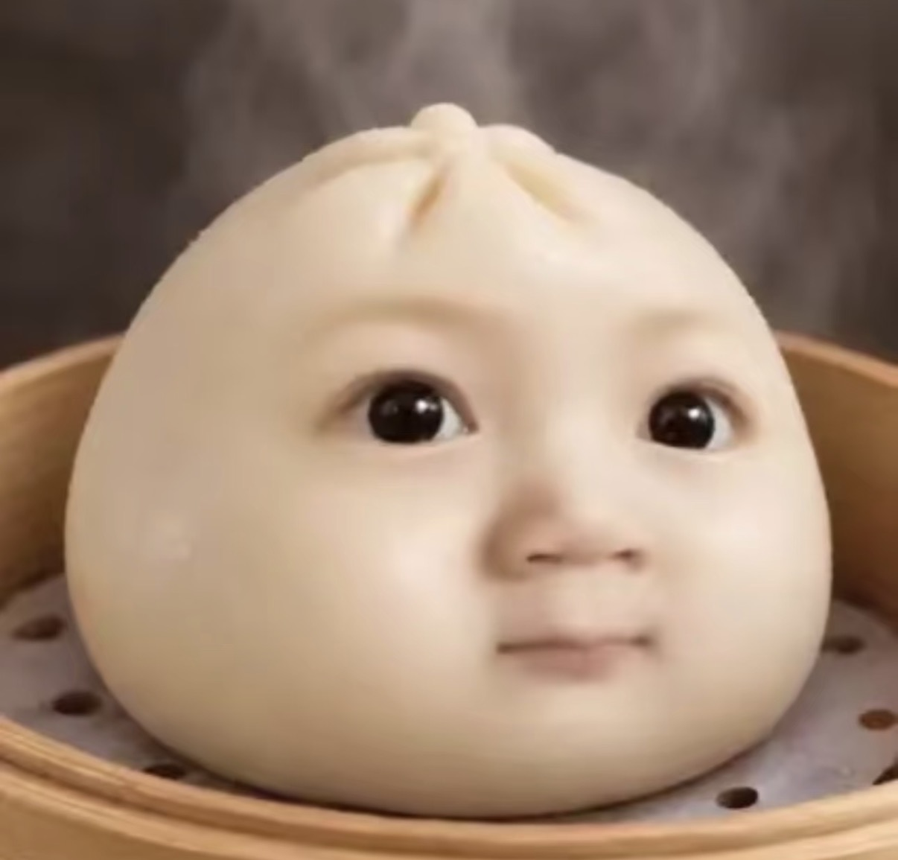

# 人和动物变包子 · Face Baozi

一个 Codex 图像编辑技能：把人或动物照片中的眉眼、鼻子、嘴巴及实际佩戴的眼镜，融入蒸笼里的包子。

**脸的方向由原照片决定；包子底图只决定造型、面皮和场景。**

## 唯一公开图片：底图 A



仓库仅包含这张获准公开的底图。不包含人物原照、宠物原照、配对样例、测试成品或相关截图，也不依赖这些未公开文件。

## 安装与使用

需要支持本地技能、参考图查看和多图编辑的 Codex 环境，以及可用的内置图像生成工具。本仓库不是独立运行的人脸替换程序。

将仓库下载或克隆到一个新的 `generate-face-baozi` 目录，再放入个人技能目录（通常为 `~/.codex/skills/`）。不要覆盖已有同名本地技能；请先自行备份，或用独立环境试用。重新打开会话后上传自己的照片，并输入：

```text
使用 $generate-face-baozi，把这张人像或动物照片变成包子。
```

每次使用两张真实图片：仓库内的 **A 底图**，以及用户当次提供的 **D 原照**。不需要 B/C 配对样例。

## 保留什么

- 原照的眉眼、鼻形、嘴形、表情；有眼镜才保留眼镜。
- 原照的正歪、转向、俯仰和视线，左右不反转。
- 五官之间的比例与位置关系；默认放在包子正面的视觉中央。
- 猫狗等动物的眼睛、瞳孔、鼻头、嘴形和吻部结构。

肤色和毛色弱化为暖奶油白面皮，仅保留必要的结构阴影和五官对比。默认不添加头发、耳朵、四肢、尾巴或衣服。动物残留的毛发纹理可再做一次局部面皮融合。

## 常见微调

```text
把整组五官往包子中央移一点，保留现在的比例、表情和倾斜。
```

```text
只把嘴周的毛发纹理改成包子面皮，保留眼睛、鼻子和嘴形。
```

## 能力边界与隐私

这是生成式图像编辑流程，不是像素级抠图粘贴或可保证身份一致的换脸算法。清晰照片仍可能出现五官重绘，尤其是遮挡、粗框眼镜和露齿表情。结果需要与原照核对，不能仅凭同样的眼镜或笑容判定相似。

开发时使用过非公开的配对范例。本公开版已改为 A+D 两图输入，完成文件与依赖检查；两图版尚未独立完成视觉回归测试，不承诺与原流程效果完全相同。

运行时原照会交给配置的图像生成服务处理，本技能不提供离线处理保证。原照和生成结果不应保存到本仓库、公开示例或 Git 历史中。

## 发布检查

```sh
python3 scripts/audit_public_release.py
```

检查公开文件白名单、唯一图片 A 的 SHA-256、JPEG 隐私元数据、文本中的本机路径/秘密模式，以及存在时的本仓库 Git 历史。脚本通过不等于生成效果通过。

## 许可

技能说明、文档及脚本采用 [MIT License](LICENSE)。底图 A 不包含在 MIT 授权范围内，见 [ASSET_LICENSE.md](ASSET_LICENSE.md)。
